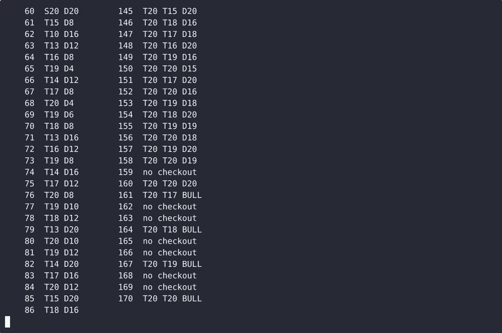

# Scorekeep — complete Full-stack app command-line tool example app

**Scorekeep** gives you two paths: self-host the Apache-2.0-licensed Full-stack app source as your own command-line tool, or [open it on cenius.ai](https://cenius.ai/marketplace/p/scorekeep?ref=gh&utm_campaign=scorekeep-webapp), describe the changes you want, and receive a new Scorekeep build with full rebrand rights. Scorekeep is a single-file, standard-library-only Python command-line darts scorer: it sets up players for a leg of 301, 501 or cricket, records each three-dart turn in standard notation (T20, D16, 25), applies bust a…. Everything ships in this repo — no paywall, no hidden features, no separate Scorekeep download.


[](LICENSE)  [](https://cenius.ai)

[](https://cenius.ai/marketplace/p/scorekeep?ref=gh&utm_campaign=scorekeep-webapp)

> **▶ [Open & edit in cenius.ai](https://cenius.ai/marketplace/p/scorekeep?ref=gh&utm_campaign=scorekeep-webapp)** — one click to an editable workspace: describe changes in plain English, get an instant preview, one-click deploy and host. Modifications made on the platform come with full rebrand & relicense rights.

_Local clone? See [Quick start](#quick-start) below. cenius.ai is the zero-setup path._

## Demo


📽 **[Demo video on cenius.ai](https://cenius.ai/marketplace/p/scorekeep?ref=gh&utm_campaign=scorekeep-webapp)** — the complete run-through · [MP4](.github/media/demo.mp4)

## Screenshots

 

## Quick start

```bash
./install.sh   # installs dependencies + seeds demo data
```

See [`INSTALL.md`](INSTALL.md) for full setup and usage instructions.

## Architecture

A self-contained Full-stack app project (26 files): top-level directories include `examples/`, `tests/`. Dependency management and data seeding are both handled by `./install.sh` — run it once, then start the server. Step-by-step setup guide: [`INSTALL.md`](INSTALL.md).

## Features

- Leg scoring for 301, 501 and cricket
- Checkout suggestion from a typed remaining score
- Per-player three-dart average history

## Usage guide

Walkthroughs of everything the tool does, with the real output. Run any block from the
project root. `python3 scorekeep.py --help` prints a short version of this.

- [Score a 501 leg](#score-a-501-leg)
- [Busts](#busts)
- [Checkouts: the table, a lookup, the live score](#checkouts-the-table-a-lookup-the-live-score)
- [Leg summary, the next leg and averages](#leg-summary-the-next-leg-and-averages)
- [Cricket](#cricket)
- [In-leg commands](#in-leg-commands)
- [Scripts and piping](#scripts-and-piping)
- [Exit codes and colour](#exit-codes-and-colour)

### Score a 501 leg

```console
$ python3 scorekeep.py --game 501 --players Alice,Bob
── Leg 1 · 501 ─────────────────────────────────────
  Players: Alice, Bob
  Player        Score
  Alice           501  next
  Bob             501
  Alice throws first.
Alice > T20 T20 S20
  Alice      T20 T20 S20  = 140  →  361
  Alice 361  |  Bob 501  — Bob to throw
Bob > S1 S1 S1
  Bob        S1 S1 S1     = 3  →  498
  Alice 361  |  Bob 498  — Alice to throw
```

One line per turn: the thrower's name, the darts as typed, the points scored, the new
remaining score, then the running board and who throws next. A turn may hold one, two
or three darts; `0` is a miss that still counts as a thrown dart.

`301` works the same way (`--game 301`). Both are double-out.

### Busts

```console
Bob > T20 T20 T20
  Bob        T20 T20 T20  = BUST (went below zero)  →  stays on 162
  Alice 170  |  Bob 162  — Alice to throw
```

_Full guide: [`USAGE.md`](USAGE.md)_

## FAQ

### What does it take to self-host Scorekeep?

Clone this repository and run `./install.sh`, then start the app as described in [`INSTALL.md`](INSTALL.md). Scorekeep is fully self-hostable — no external services are required to try it.

### Is it OK to ship Scorekeep as part of a product?

Confirmed free for commercial use — MIT terms let you incorporate, resell, or ship it in any product. [LICENSE](LICENSE).

### Can non-developers customise Scorekeep?

Describe what you want changed on [cenius.ai](https://cenius.ai/marketplace/p/scorekeep?ref=gh&utm_campaign=scorekeep-webapp) — no code editing needed; the platform produces a fresh build you can download and deploy.

### How is Scorekeep built technically?

Powered by Full-stack app. This repo is the real thing — full source, seed data, and all — ready to clone and start up. Highlights include checkout suggestion from a typed remaining score.

### How do I make Scorekeep my own brand?

White-labeling is supported: fork the MIT-licensed source and rebrand it yourself, or use [cenius.ai](https://cenius.ai/marketplace/p/scorekeep?ref=gh&utm_campaign=scorekeep-webapp) to make changes in a guided workspace — platform modifications come with full rebrand rights.

## License & rebranding

Released under the [Apache License 2.0](LICENSE) (© 2026 Cenius AI) — free for personal and commercial use. The Cenius name/logo are trademarks (see NOTICE).

**Need a customized version?** [Remix this app on cenius.ai](https://cenius.ai/marketplace/p/scorekeep?ref=gh&utm_campaign=scorekeep-webapp) — modifications made on the platform come with **full rebrand & relicense rights** over your derivative.

## Built with cenius.ai

This entire application — code, design, seeded demo data — was generated on **[cenius.ai](https://cenius.ai)** from a plain-English description.

- 🚀 [Build your own app on cenius.ai](https://cenius.ai)
- 🎛️ [Remix Scorekeep on the marketplace](https://cenius.ai/marketplace/p/scorekeep?ref=gh&utm_campaign=scorekeep-webapp) — open it in a workspace, prompt for changes, and ship your own version.

More open-source apps: [the Cenius-ai catalog](https://github.com/Cenius-ai) · [showcase index](https://github.com/Cenius-ai/showcase)
